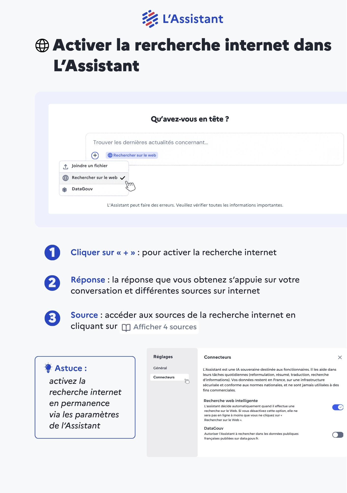

# Activer la rercherche internet dans L'Assistant



1. **Cliquer sur « + »** : pour activer la recherche internet
2. **Réponse** : la réponse que vous obtenez s’appuie sur votre conversation et différentes sources sur internet
3. **Source** : accéder aux sources de la recherche internet en cliquant sur "_afficher les sources_"


<mark style="color:blue;">**Astuce :**</mark>\
Activez la recherche internet en permanence via les paramètres de l’Assistant




<figure><figcaption></figcaption></figure>

<a href="https://ia.numerique.gouv.fr/documents/44/Recherche_internet.pdf" class="button primary">Télécharger la fiche réflexe</a>




**Plus d'information sur la recherche internet :** [recherche-web.md](../recherche-web.md "mention")
