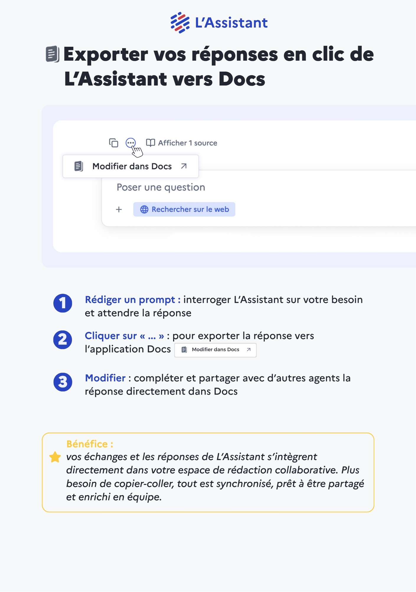

# Exporter vos réponses en clic de L’Assistant vers Docs



1. **Rédiger un prompt** : interroger L’Assistant sur votre besoin et attendre la réponse
2. **Cliquer sur « ... »** : pour exporter la réponse vers l’application Docs
3. **Modifier** : compléter et partager avec d’autres agents la réponse directement dans Docs


<mark style="color:green;">**Bénéfice :**</mark>

vos échanges et les réponses de L’Assistant s’intègrent directement dans votre espace de rédaction collaborative. Plus besoin de copier-coller, tout est synchronisé, prêt à être partagé et enrichi en équipe.




<figure><figcaption></figcaption></figure>

<a href="https://ia.numerique.gouv.fr/documents/41/Export_Docs.pdf" class="button primary">Télécharger la fiche réflexe</a>



